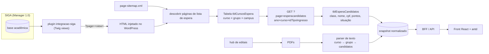

# Mapeamento de endpoints — CDARA / UFJF

Levantamento feito em **19/11/2026** sobre `https://www2.ufjf.br/cdara`.

O site é um **WordPress 4.9.7** (tema `wpufjf_academico`) com um plugin proprietário,
`integracao-siga`, que renderiza **views Twig** com dados acadêmicos e injeta o HTML no
meio do conteúdo das páginas. Esse plugin é o elo WordPress ↔ SIGA e **não é exclusivo da
CDARA** — também roda em `www2.ufjf.br/cat` e `www2.ufjf.br/energia`.

Não existe API pública de convocações: os dados são **HTML + PDFs**.

---

## 1. Visão geral das fontes

| Fonte | O que entrega | Formato | Estabilidade |
|---|---|---|---|
| WordPress REST (`/wp-json/wp/v2`) | páginas, títulos, conteúdo HTML, datas | JSON | alta |
| `?page=<view>` (plugin `integracao-siga`) | views acadêmicas renderizadas do SIGA (lista de espera, catálogo de cursos, currículos, planos de ensino, turmas) | HTML (Twig inline) | média (layout fixo, contrato não documentado) |
| PDFs de edital | convocados por curso/grupo, datas, regras | PDF texto | média (texto extraível) |
| SIGA (`siga.ufjf.br` / `sigam.ufjf.br`) | pré-matrícula (formulário externo) | HTML | link apenas |

> ⚠️ Nada disso é oficialmente uma API. O plano de implementação trata o scraping como
> **ETL com snapshot + validação**, nunca como dependência síncrona do front.

---

## 2. WordPress REST API

Base: `https://www2.ufjf.br/cdara/wp-json`

| Endpoint | Uso |
|---|---|
| `GET /wp/v2/pages?per_page=100&page=N&_fields=id,slug,link,title,modified,parent` | enumerar páginas (hub de editais, cronogramas) |
| `GET /wp/v2/pages?search=convocados` | descobrir páginas novas |
| `GET /wp/v2/pages/{id}` | conteúdo renderizado (`content.rendered`) da página |
| `GET /cdara/page-sitemap.xml` | 505 páginas publicadas (fonte de descoberta) |
| `GET /wp/v2/media?parent={id}` | anexos de uma página |

Namespaces expostos: `wp/v2`, `yoast/v1`, `cmb2/v1`, `foogallery/v1`, `jwt-auth/v1`, `siga/v1`.
O namespace `siga/v1` **não** expõe dados acadêmicos — só `GET /siga/v1/user-sites` (401 sem login).

> ⚠️ **`/wp/v2/pages` está quebrado neste site**: responde `200` com `Content-Type:
> application/json`, mas o corpo é **HTML renderizado** (outro plugin intercepta a rota),
> não JSON. Use o `page-sitemap.xml` + fetch das páginas para descoberta. As rotas
> `/wp/v2/media`, `/wp/v2/posts` e `/wp-json/` (índice) funcionam normalmente.

---

## 3. A integração SIGA (plugin `integracao-siga`)

### 3.1 O que é o SIGA

O **SIGA — Sistema Integrado de Gestão Acadêmica** é o sistema de registro acadêmico da
UFJF (matrícula, histórico, turmas, currículos). É a **fonte da verdade** por trás das
tabelas que aparecem no WordPress.

| Item | Observação |
|---|---|
| Hosts | `siga.ufjf.br` e `sigam.ufjf.br` (mesma aplicação, dois domínios usados nos links de pré-matrícula) |
| Stack | PHP sobre o framework **Manager 1.0** (`<meta name="Generator" content="Manager 1.0; http://www.maestro.org.br">`), front controller `index.php/...`, jQuery 1.9 + Dojo |
| Roteamento | `https://siga.ufjf.br/index.php/siga/publico/<área>/<ação>/<params>` |
| API | **não há API pública documentada** |

Comportamento de roteamento (testado): `/siga/publico/academico` responde `200` com a
casca do sistema; `/siga/publico/processoseletivo`, `/vestibular`, `/candidato`, `/ws`,
`/api` respondem `404`; **qualquer sub-rota desconhecida de `academico` devolve a mesma
casca com `200`**. Ou seja, **não dá para enumerar ações públicas pelo status HTTP**.

### 3.2 Como o WordPress conversa com o SIGA

O plugin `integracao-siga` funciona como **camada de apresentação com views Twig**:

```
SIGA (dados)  ──►  integracao-siga (PHP + Twig)  ──►  HTML injetado no the_content do WP
```

Evidências coletadas:

| Evidência | Como foi obtida |
|---|---|
| Bloco delimitado por `<!--INICIO DO TEMPLATE-->` … `<!--FIM DO TEMPLATE (fetch time: 0.14s)-->` | inspeção do HTML |
| `fetch time` de **0,11–0,18 s** em todas as views | comentário gerado pelo próprio plugin |
| HTML é **acrescentado** ao conteúdo da página (não substitui) | o bloco aparece depois dos parágrafos, dentro do `div` de conteúdo |
| `?page=<view>` escolhe a view; `view=<view>` é alias | teste com `page=cursos` e `view=cursos` |
| A view só renderiza em páginas que declaram o shortcode | `/pism-e-vestibular-2026/?page=esperacandidatos` → sem bloco |
| **Whitelist por página** | na lista de espera do CDARA as 8 views conhecidas renderizam; em `/cat/servicos/cursos/curriculos-ativos/` qualquer `?page=` é ignorado e a página sempre mostra `curriculos-ativos` |
| Namespace REST próprio `siga/v1` | `GET /wp-json/` → rotas `/siga/v1` e `/siga/v1/user-sites` (401) |
| Plugin não serve assets | `wp-content/plugins/integracao-siga/*` → 404; só a classe CSS `integracao-siga` vaza no HTML |

**Transporte (não confirmado):** o `fetch time` e a latência sugerem chamada HTTP interna,
mas não foi possível observar o host de origem. Dois indícios apontam para consulta não
escapada no backend: um `'` cru em `curso` devolve **HTTP 500** com a página truncada
(erro fatal de PHP, com `display_errors` desligado), e parâmetros inválidos devolvem
**200 com tabela vazia**. Não prossiga com fuzzing — trate o endpoint como somente leitura.

Semântica de cache: respostas com template vêm com `Cache-Control: no-store` e **ignoram**
o microcache do WordPress (páginas normais trazem `microcache-status: MISS`; as views não
trazem o header).

### 3.3 Registro de views conhecidas

Levantadas por crawl do sitemap da CDARA (504 páginas), do CAT (77) e do Energia (14), mais
exploração da convenção kebab-case dos nomes.

| View (`?page=`) | Parâmetros | Tabela / âncora | Conteúdo | Onde aparece |
|---|---|---|---|---|
| **`esperacandidatos`** | `ano`, `curso`, `idTipoIngresso`, `semestre`, `cursoNome` | `tblEsperaCandidatos` | candidatos de um curso × grupo (classificação, nome, CPF, pontos, situação) | 21 páginas da CDARA |
| `cursos` | — | `tblCursos` | catálogo de cursos da UFJF (~375 linhas: código, nome, campus, turno) | não linkada na CDARA |
| `curriculos-ativos` | `codCurso` | — | currículos ativos do curso (links para `grade-curricular`) | CAT |
| `grade-curricular` | `codCurso`, `codCurriculo` | — | grade por período, com pré-requisitos (links para `plano-de-ensino`) | CAT |
| `plano-de-ensino` | `codDisciplina` | `#plano-de-ensino` | ementa, carga horária, departamento, bibliografia | CAT, Energia |
| `disciplinas` | — | `tblDisciplinas` | catálogo de disciplinas | Energia |
| `plano-departamental` | — | `#grade-plano-departamental` | planos de ensino por semestre do departamento (~2,3 MB de HTML) | Energia |
| `turma` | `idturma` | `#template_turma` | docente, horários e reservas de vagas da turma | Energia |

Cadeia de navegação: `cursos` → `curriculos-ativos` (por `codCurso`) →
`grade-curricular` (por `codCurriculo`) → `plano-de-ensino` (por `codDisciplina`).

> **Correção importante:** a versão anterior deste documento afirmava que `page` aceitava
> **apenas** `esperacandidatos`. Isso é falso — a limitação é da *whitelist de cada página*,
> não do endpoint. Na página de lista de espera do CDARA, `?page=cursos`,
> `?page=curriculos-ativos`, `?page=grade-curricular`, `?page=plano-de-ensino`,
> `?page=disciplinas`, `?page=plano-departamental` e `?page=turma` **também renderizam**.

### 3.4 Onde o plugin está instalado

| Site | Views usadas | Papel |
|---|---|---|
| `www2.ufjf.br/cdara` | `esperacandidatos` (+ as demais, por whitelist) | listas de espera dos processos seletivos |
| `www2.ufjf.br/cat` | `curriculos-ativos`, `grade-curricular`, `plano-de-ensino`, `disciplinas` | consulta pública de currículos e planos de ensino |
| `www2.ufjf.br/energia` | `plano-departamental`, `disciplinas`, `plano-de-ensino`, `turma` | portal do departamento |
| `www2.ufjf.br/prograd`, `/ufjf`, `/noticias`, `/estagio` | — | plugin ausente |

Consequência prática: **só `esperacandidatos` interessa à matrícula**. As outras views
explicam por que o endpoint aceita `?page=` arbitrário e servem de referência de estilo
(são as mesmas tabelas Bootstrap + DataTables).

### 3.5 Superfície pública do SIGA

| Recurso | URL |
|---|---|
| Pré-matrícula on-line | `https://siga.ufjf.br/index.php/siga/publico/academico/formPreMatriculaP1/{id}/` |
| Pré-matrícula (SIGA-M) | `https://sigam.ufjf.br/index.php/siga/publico/academico/formPreMatriculaP1/{id}/` |
| Área do Candidato | `https://ingresso.ufjf.br` (SPA Angular, login por CPF — sistema distinto do SIGA acadêmico) |

O `{id}` do `formPreMatriculaP1` é **por edital** (ex.: `518` no 7º edital PISM 2026/2) e
vem no `<li>` da página de editais, ao lado do período de confirmação.

### 3.6 O que ainda não foi determinado

- o **transporte real** (HTTP interno vs. conexão direta ao banco do SIGA) e o host de origem;
- a **lista completa de views** — as 8 acima são as alcançáveis; nomes fora da convenção
  (`convocados`, `classificacao`, `resultados`, …) retornam a página sem bloco;
- a semântica de `siga/v1/user-sites` (protegida por login);
- se existe cache interno atrás do `fetch time`;
- se o `?page=` aceita nome arbitrário de template (testados 30 nomes: só os 8 acima
  renderizaram).

---

## 4. Endpoint de dados: `esperacandidatos` (o principal)

### 4.1 Assinatura

```
GET https://www2.ufjf.br/cdara/{pagina-com-shortcode}/?page=esperacandidatos
      &ano={AAAA}
      &curso={codigoSIGA}
      &idTipoIngresso={idGrupo}
      &semestre={1|2|""}
      &cursoNome={nome para o título}
```

**Descobertas importantes (testadas):**

- A view só renderiza em páginas que possuem o shortcode `integracao-siga`
  (as 21 páginas de *Lista de Espera*). A mesma query em `/pism-e-vestibular-2026/` não
  retorna bloco algum. → **Use sempre a URL da lista de espera da edição como base.**
- Parâmetros obrigatórios de fato: `ano`, `curso`, `idTipoIngresso`.
- `semestre` é aceito e vem vazio nas edições 2026 (`semestre=2` em página de 1º semestre
  devolve 0 linhas).
- `cursoNome` é opcional: só preenche o `<h2>` do bloco (sem ele, a tabela vem igual).
- Resposta: `200` sempre — erros aparecem como **tabela vazia** (0 linhas).
- **Não há filtro nem paginação**: `cpf`, `nome`, `q`, `busca`, `limit`, `offset`,
  `situacao` são ignorados — a view sempre devolve a lista inteira do curso/grupo.
- Não há modo JSON: `Accept: application/json`, `format=json`, `ajax=1` e `.json` no nome
  da view não alteram a resposta.
- Cabeçalho `Cache-Control: no-store, no-cache, must-revalidate` → **cache é responsabilidade nossa.**
- Tempo de geração reportado no próprio HTML: `<!--FIM DO TEMPLATE (fetch time: 0.16s)-->`.

### 4.2 Delimitação no HTML

```html
<!--INICIO DO TEMPLATE-->
<div id='twig_template' class='integracao-siga'>
  ...
</div>
<!--FIM DO TEMPLATE (fetch time: 0.16s)-->
```

### 4.3 Tabela de cursos (vem inline na página, sem query)

`<table id="tblCursosEspera">` — colunas: `CURSO | TURNO | GRUPO | CAMPUS`.

Cada linha carrega a query do detalhe:

```html
<tr class="disciplinas"
    onclick="window.location='?page=esperacandidatos&ano=2026&curso=01GV&idTipoIngresso=326&semestre=&cursoNome=ADMINISTRAÇÃO';">
  <td>ADMINISTRAÇÃO</td><td>INTEGRAL</td><td>SISU MAIS - GRUPO A</td><td>GOVERNADOR VALADARES</td>
</tr>
```

Ou seja: **a lista de cursos é o índice do endpoint**. Para sincronizar uma edição inteira,
basta ler essa tabela e iterar as linhas.

### 4.4 Tabela de candidatos (`page=esperacandidatos`)

`<table id="tblEsperaCandidatos">` — colunas: `CLASS | NOME | CPF | PONTOS | SITUAÇÃO`.

```html
<tr class="disciplinas">
  <td align="center">1</td>
  <td align="center">PATRICK RIAN ROMULO SILVA</td>
  <td class="selecao" style="cursor: pointer;">161.XXX.XXX-51</td>
  <td class="selecao" style="cursor: pointer;">600,56</td>
  <td class="campus">CONVOCADO PELO EDITAL PUBLICADO EM 24/07/2026</td>
</tr>
```

Observações de parsing:

- `PONTOS` usa **vírgula decimal** (`600,56`) e às vezes inteiro (`551`).
- `CPF` vem **mascarado** pelo próprio governo (`161.XXX.XXX-51`) — dado público, mas ainda
  assim é dado pessoal: ver LGPD no plano.
- `SITUAÇÃO` tem dois formatos:
  - `EM ESPERA`
  - `CONVOCADO PELO EDITAL PUBLICADO EM dd/mm/aaaa`
  → extrair `convocado_em` como data e `convocado = true`.
- Nomes vêm em caixa alta, mas há exceções (`Juan`, `Maria Eduarda`, `Marina Miosso`).
  **Não normalize o nome**; guarde o original e um campo derivado para busca.

### 4.5 Volumetria real (edição 2026)

| Página (edição) | Linhas curso×grupo | Cursos distintos | Grupos |
|---|---|---|---|
| `.../pism-vestibular/lista-de-espera-pism-3/` (PISM 2026) | 273 | 56 | A,B,C,D,E,G,H,J |
| `.../sisu/lista-de-espera-sisu/` (SiSU 2026) | 485 | 56 | A,B,C,D,E,G,H,J |
| `.../lista-de-espera-pism-5/lista-de-espera-sisu-mais/` (SiSU Mais 2026) | 16 | 2 (GV) | A,B,C,D,E,G,H,J |

Exemplo de detalhe: `ADMINISTRAÇÃO / GV / Grupo A` → **63 candidatos**.

### 4.6 `idTipoIngresso` é **por edição** — não hardcode

Mesmo grupo lógico muda de id conforme o ano:

| Edição | Grupo A | Grupo H | Grupo J |
|---|---|---|---|
| SiSU 2022 | 70 | 147 | 151 |
| SiSU 2024 | 70 | 239 | 246 |
| SiSU 2026 | 70 | 239 | 246 |
| SiSU Mais 2026 | 326 | 328 | 330 |
| PISM 2026 | 75 | 299 | 301 |
| EAD 2025 | 262 | 266 | 268 |
| PARFOR 2024 | 275 | 277 | 278 |

Regra: o id é sempre lido da página da edição, junto com o rótulo do grupo.

### 4.7 Mapa das páginas que expõem a tabela (varredura do sitemap)

| Edição | Página | Linhas | `idTipoIngresso` |
|---|---|---|---|
| PISM 2022 | `.../pism-e-vestibular-de-musica-2022/lista-de-espera-pism/` | 311 | 75-79, 175-177 |
| SiSU 2022/1 | `.../sisu/sisu-2022-1a-edicao/lista-de-espera-sisu/` | 313 | 70-74, 145-151 |
| SiSU 2022/2 | `.../sisu/sisu-2022-2a-edicao/lista-de-espera-sisu-2a-edicao-2022/` | 215 | 70-74, 145-151 |
| EAD 2022 | `.../vestibular-ead/.../lista-de-espera-ead-2022/` | 50 | 81-84, 156-159 |
| PISM 2023 | `.../pism-vestibular/lista-de-espera-pism/` | 262 | 75-79, 175-178 |
| SiSU 2023 | `.../sisu/sisu-2023-2a-edicao/lista-de-espera-sisu/` | 203 | 70-74, 145-151 |
| PISM 2024 | `.../pism-vestibular/lista-de-espera-pism-2/` | 308 | 75-79, 175-177 |
| Vestibular 2024 | `.../pism-vestibular/lista-de-espera-vestibular/` | 7 | 81,82,84,156 |
| SiSU 2024 | `.../sisu/sisu-2024/lista-de-espera-sisu/` | 414 | 70-74, 236-246 |
| EAD 2022 (2) | `.../vestibular-ead/lista-de-espera-ead-2/` | 95 | 137-141, 152-154 |
| PARFOR 2024 | `.../graduacao/lista-de-espera-parfor-professores/` | 4 | 275-278 |
| SiSU 2025 | `.../sisu/sisu-2025/lista-de-espera/` | 397 | 70-74, 236-246 |
| EAD 2025 (prof.) | `.../vestibular-ead/ead-2025/lista-de-espera-ead-professores/` | 9 | 214,218,221 |
| EAD 2025 (hist.) | `.../vestibular-ead/ead-2025/lista-de-espera-ead-historico/` | 128 | 259-268 |
| PISM 2025 | `.../pism-vestibular/lista-de-espera-pism-2025/` | 265 | 75-79, 299-301 |
| **PISM 2026** | `.../pism-vestibular/lista-de-espera-pism-3/` | **273** | 75-79, 298-301 |
| **SiSU 2026** | `.../sisu/lista-de-espera-sisu/` | **485** | 70-74, 236-246 |
| **SiSU Mais 2026** | `.../pism-vestibular/lista-de-espera-pism-5/lista-de-espera-sisu-mais/` | **16** | 326-333 |
| PISM 2023 (alt) | `.../pism-vestibular/lista-de-espera-pism-5/lista-de-espera/` | 304 | 70-74, 145-151 |

> A página `.../lista-de-espera-pism-5/lista-de-espera/` está com `ano=2023` apesar do nome —
> é conteúdo legado. Sempre confirme `ano` e `idTipoIngresso` lendo a própria tabela.

---

## 5. Convocações e reclassificações (PDFs)

### 5.1 Hubs por processo

| Processo | Hub | Conteúdo |
|---|---|---|
| PISM / Vestibular / Música | `/pism-e-vestibular-2026/` | edital de matrícula, cronograma, links para convocações |
| SiSU | `/sisu-2026/` | convocados 1º/2º semestre |
| SiSU+ | `/graduacao/matricula-graduacao/sisu/sisu-2026/` | convocados SiSU+ |
| Editais PISM | `/editais-de-reclassificacao/editais-de-reclassificacao/` | 13 PDFs, 1º e 2º semestre |
| Editais SiSU Mais | `/editais-de-reclassificacao-4/` | 4 PDFs (2º semestre) |
| Vagas Ociosas | `/graduacao/vagas-ociosas-2/processo-seletivo-vagas-ociosas/` | 15 PDFs (edital, isenção, modalidades, resultados) |
| PISM/SiSU Vagas Ociosas | `/pism-sisu-vagas-ociosas/` | resultados |
| Grupos de cotas | `/cronograma-e-resultados-grupos-de-cotas/` | **78 PDFs** (renda, PcD, heteroidentificação, recursos) |
| Bancas de heteroidentificação | `/convocacoes-bancas-de-heteroidentificacao-grupos-a-e-d-sisu/` | **42 PDFs** (listas por campus) |
| EAD | `/graduacao/matricula-graduacao/vestibular-ead/ead-2025/` | cronogramas + listas |

### 5.2 Estrutura HTML das listas de editais

Cada hub é uma sequência de `<h3>` (semestre/processo) → `<ul>` → `<li>`:

```html
<h3>2º SEMESTRE – PISM</h3>
<ul>
  <li><a href=".../7ºEditalPISMSemestre2..pdf">7º Edital de Reclassificação - PISM / PISM Vagas Ociosas</a></li>
  <li><a href="https://siga.ufjf.br/index.php/siga/publico/academico/formPreMatriculaP1/518/">Link 1 pré-matrícula on-line</a> (das 12h do dia 02/09/26 até as 23h59 do dia 04/09/26).</li>
</ul>
```

→ dá para extrair **edital + link de pré-matrícula + janela de datas** por regex, sem PDF.

### 5.3 Contrato do PDF de convocação (texto extraível)

```
CDARA - COORDENAÇÃO DE REGISTROS ACADÊMICOS
...
7º Edital de Reclassificação PISM/ PISM Vagas Ociosas - 2º semestre
[parágrafo com prazos: "entre as 12h do dia 02/09/2026 e as 23h59 do dia 04/09/2026"
                          e "envio da documentação entre os dias 09/09/2026 a 11/09/2026"]

{CURSO} - {TURNO} - {CAMPUS}
{GRUPO}                       <-- "PISM Grupo C" | "SISU - GRUPO A" | "SISU MAIS - GRUPO B"
1 - {CPF_MASCARADO} {NOME}
2 - {CPF_MASCARADO} {NOME}
...
{CURSO} - {TURNO} - {CAMPUS}
...
*** Vagas originárias de editais de vagas ociosas.
Total de candidatos:65
Juiz de Fora, 13 de novembro de 2026
```

Regex de referência:

```python
CURSO   = r'^(?P<curso>[A-ZÀ-Ü][^\-]+?) - (?P<turno>[A-ZÀ-ÜÇ ]+?) - (?P<campus>[A-ZÀ-ÜÇ ]+)$'
GRUPO   = r'^(?:PISM|SISU)(?: MAIS)?(?: -)?\s*Grupo\s+[A-Z]$'
CAND    = r'^(?P<ord>\d+) - (?P<cpf>[\d]{3}\.XXX\.XXX-[\d]{2}) (?P<nome>.+?)(?P<obs>\s\*\*\*)?$'
PRAZO   = r'entre as (\d{2}h) do dia (\d{2}/\d{2}/\d{4}) e as (\d{2}h\d{2}) do dia (\d{2}/\d{2}/\d{4})'
DOCS    = r'envio da documentação entre os dias (\d{2}/\d{2}/\d{4}) a (\d{2}/\d{2}/\d{4})'
TOTAL   = r'Total de candidatos:\s*(\d+)'
```

Cuidados:

- O PDF vem em **CP1252**; extraia bytes → decodifique sem assumir UTF-8.
- Curso/turno/campus estão em **caixa alta**; `ABI - CIÊNCIAS BIOLÓGICAS - INTEGRAL - JUIZ DE FORA`.
- Listas podem quebrar entre páginas no meio de um grupo → concatene páginas antes de parsear.
- `***` marca vaga oriunda de vagas ociosas (importante para explicar ao candidato).
- O nome do arquivo **não é confiável** (`Convocados2sem..pdf`, `4EditalSISUMAIS..pdf`).
  O número/tipo do edital deve vir do texto e/ou do `<a>` da lista.

### 5.4 Padrão de URL de anexo (para checar novidade)

```
/wp-content/uploads/sites/82/{AAAA}/{MM}/{slug}.pdf
```

`HEAD` no PDF + `Last-Modified`/`Content-Length` é um bom gatilho de reingestão.

---

## 6. Links externos relevantes

| Serviço | URL |
|---|---|
| Pré-matrícula (SIGA) | `https://siga.ufjf.br/index.php/siga/publico/academico/formPreMatriculaP1/{id}/` |
| Pré-matrícula (SIGA-M) | `https://sigam.ufjf.br/index.php/siga/publico/academico/formPreMatriculaP1/{id}/` |
| Observatório de Dados | `https://observatorio.homolog.ufjf.br/` (link em `/dados-abertos/`) |
| Calendário acadêmico | `/graduacao/calendario-academico/` |
| Dúvidas frequentes | `/graduacao/duvidas-frequentes/` |

---

## 7. Resumo operacional



**Custo de sincronização de uma edição completa:**

- 1 request por página de lista (índice de cursos)
- 1 request por linha curso×grupo (273 + 485 + 16 ≈ 774 requests na edição 2026)
- ~0,2–0,5 s por request, concorrência 4–6 → **2 a 4 minutos**
- ~20–40 mil registros de candidatos por edição (estimativa a partir de 63 candidatos/grupo)
